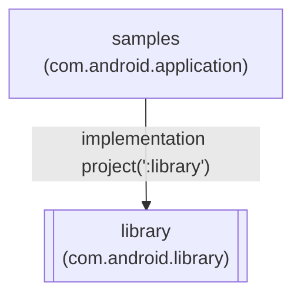

<div align="center">

# 📚 android-emulator-detector

**Android library (Kotlin) that flags emulators from build, file, telephony and package signals · sync · callback**

An Android library (AAR) that tells an app whether it is probably running on an emulator. It is a
Glovo fork of [framgia/android-emulator-detector](https://github.com/framgia/android-emulator-detector),
converted to Kotlin and moved to AndroidX, and it ships through JitPack. It is a heuristic yes/no
built from known emulator fingerprints. It is not a root, tamper or fraud detector, and it is not a service.

[](build.gradle)
[](build.gradle)
[](gradle/wrapper/gradle-wrapper.properties)
[](library/build.gradle)
<br/>
[](#adding-an-emulator-check-to-an-app)
[](LICENSE)
[](#contributing--conventions)

</div>

---

## Table of contents

- [Overview](#overview)
- [Modules](#modules)
- [Adding an emulator check to an app](#adding-an-emulator-check-to-an-app)
- [Build & local development](#build--local-development)
- [Security & data handling](#security--data-handling)
- [Repository layout](#repository-layout)
- [Contributing & conventions](#contributing--conventions)
- [Glossary](#glossary)
- [Ownership & support](#ownership--support)

---

## Overview

An app calls `EmulatorDetector.with(context)`, sets a few options, then calls either **`detect()`**,
which runs on the calling thread and returns a `Boolean`, or **`detect(listener)`**, which starts a
new background thread and calls `onResult(isEmulator)` on that thread. Detection runs three stages
in order and **stops at the first positive**: basic `Build` properties, then advanced checks (telephony,
emulator files, QEMU drivers and pipes, network address, QEMU system properties), then installed emulator packages.

Glovo forked upstream **1.4.0** (Java, package `com.framgia.android.emulator`) in August 2020, converted
it to Kotlin under `com.glovoapp.emulatordetector`, enabled AndroidX and released **1.5.0 to 1.5.2**.
**The last commit on `master` is from 2020-08-18.** Upstream (Framgia) said it would periodically check
the latest emulator versions and combine them with statistics from its own projects, and that the
project drew on ideas from other projects.

| Module | Role | Published ✅/— |
|---|---|---|
| [`library`](library) | The detector: `EmulatorDetector`, `OnEmulatorDetectorListener` | ✅ JitPack AAR |
| [`samples`](samples) | Demo app that shows the result, the telephony flag and the device info | — |

| | |
|---|---|
| Language / build | Kotlin 1.3.72 · Gradle 6.1.1 · Android Gradle Plugin 4.0.1 |
| Android SDK | library `minSdkVersion 8` · `compileSdkVersion`/`targetSdkVersion` 30 · build tools 30.0.1 |
| Artifact | `com.github.Glovo:android-emulator-detector` (AAR on JitPack; latest tag `1.5.2`) |
| Runtime dependencies | `kotlin-stdlib-jdk7` 1.3.72; AndroidX is `compileOnly`, so the app must provide it |
| Upstream | [framgia/android-emulator-detector](https://github.com/framgia/android-emulator-detector) ([Android Arsenal listing](http://android-arsenal.com/details/1/3635)) |
| Owner | none declared (no CODEOWNERS, no `catalog-info.yaml`) |

### What it checks

All checks live in [`EmulatorDetector.kt`](library/src/main/java/com/glovoapp/emulatordetector/EmulatorDetector.kt).

| Stage | Check | Emulator signal | Needs |
|---|---|---|---|
| 1. Basic | `Build` properties | `FINGERPRINT` starts with `generic`; `MODEL`/`PRODUCT`/`HARDWARE` such as `google_sdk`, `sdk`, `sdk_x86`, `vbox86p`, `goldfish`, `vbox86`, `droid4x`, `Emulator`, `Android SDK built for x86`; manufacturer `Genymotion`; `nox` in board, bootloader, hardware, product or serial; brand and device both start with `generic` | — |
| 2. Advanced | Telephony | phone number `15555215554`–`15555215584`, a known device ID, IMSI `310260000000000`, or operator name `android` | `setCheckTelephony(true)`, `READ_PHONE_STATE` granted, device has telephony |
| | Emulator files | Genymotion sockets (`/dev/socket/genyd`, `/dev/socket/baseband_genyd`), Andy and Nox init files | — |
| | QEMU drivers | `goldfish` in `/proc/tty/drivers` or `/proc/cpuinfo` | — |
| | QEMU pipes | `/dev/socket/qemud` or `/dev/qemu_pipe` exists | — |
| | Network | `/system/bin/netcfg` shows `10.0.2.15` on `wlan0`, `tunl0` or `eth0` | `INTERNET` permission |
| | QEMU properties | at least 5 of 15 system properties match (`MIN_PROPERTIES_THRESHOLD`), **and** an x86 VM init file exists | — |
| 3. Package | Installed emulator apps | a listed package has a launchable activity; defaults `com.google.android.launcher.layouts.genymotion`, `com.bluestacks`, `com.bignox.app` | `setCheckPackage(true)` (the default) |

<details><summary><b>Emulators covered (upstream's last check: 16/01/2017)</b></summary>

Upstream checked these before the fork. Nobody has re-checked them since the Glovo fork.

- Real devices in [AWS Device Farm](https://aws.amazon.com/device-farm/)
- BlueStacks
- Genymotion
- Android Emulator
- Andy 46.2.207.0
- MEmu play
- Nox App Player
- Koplayer

</details>

---

## Modules



| Module | Build type | Main class or artifact | Notes |
|---|---|---|---|
| [`library`](library/build.gradle) | `com.android.library` + Kotlin | `EmulatorDetector` → `com.github.Glovo:android-emulator-detector` | `androidx.appcompat:appcompat:1.2.0` is `compileOnly`; release build is not minified |
| [`samples`](samples/build.gradle) | `com.android.application` | [`MainActivity`](samples/src/main/java/com/glovoapp/emulatordetector/MainActivity.kt) (`applicationId com.glovoapp.emulatordetector`) | Declares `READ_PHONE_STATE` and `INTERNET`; calls `detect()` with telephony on |

**Package gotcha:** the library's [`AndroidManifest.xml`](library/src/main/AndroidManifest.xml) still
declares `package="com.framgia.android.emulator"`. Its generated `BuildConfig` is therefore
`com.framgia.android.emulator.BuildConfig` (the sample imports it), while the Kotlin sources live in
`com.glovoapp.emulatordetector`.

---

## Adding an emulator check to an app

1. Add JitPack at the end of the repositories in your root `build.gradle`:

   ```groovy
   allprojects {
       repositories {
           ...
           maven { url "https://jitpack.io" }
       }
   }
   ```

2. Add the dependency (tags `1.5.0`, `1.5.1` and `1.5.2` are built on [JitPack](https://jitpack.io/#Glovo/android-emulator-detector)):

   ```groovy
   dependencies {
       implementation 'com.github.Glovo:android-emulator-detector:1.5.2'
   }
   ```

3. Make sure the app depends on AndroidX core (for example through `androidx.appcompat`). The library
   calls `androidx.core.content.ContextCompat` but compiles against AndroidX only as `compileOnly`.
4. Declare the permissions that the advanced checks use. The library's manifest declares none:
   - `android.permission.READ_PHONE_STATE` for the telephony check (IMEI, operator network, device ID…), only when you call `setCheckTelephony(true)`.
   - `android.permission.INTERNET` to detect virtual networking.
5. Run the detector:

   ```kotlin
   EmulatorDetector.with(context)
       .setCheckTelephony(true)              // needs READ_PHONE_STATE; see the warning below
       .addPackageName("com.bluestacks")
       .setDebug(BuildConfig.DEBUG)
       .detect(object : OnEmulatorDetectorListener {
           override fun onResult(isEmulator: Boolean) {
               // runs on a background thread
           }
       })

   val isEmulator = EmulatorDetector.with(context).detect()   // synchronous, since 1.5.2
   ```

> [!WARNING]
> **The telephony check can crash on Android 10+.** `checkPhoneNumber()`, `checkDeviceId()` and `checkImsi()` call
> `TelephonyManager` with no `try/catch`. For an app that targets API 29+, `getDeviceId()`/`getSubscriberId()` throw
> `SecurityException` unless the app is privileged ([TelephonyManager reference](https://developer.android.com/reference/android/telephony/TelephonyManager)).
> With `setCheckTelephony(true)` and `READ_PHONE_STATE` granted, the exception escapes `detect()`, or is thrown
> on the background thread that `detect(listener)` starts.

> [!NOTE]
> `detect(listener)` calls `onResult` on its own background thread, so switch to the main thread before you touch views.
> `detect()` blocks the calling thread while it reads files and runs `/system/bin/netcfg`. `with()` keeps the first instance
> for the life of the process, so options and added package names carry over between calls.

<details><summary><b>Options</b></summary>

| Method | Default | Effect |
|---|---|---|
| `setCheckTelephony(Boolean)` | `false` | Checks IMEI/device ID, IMSI, phone number and operator network. Needs `android.permission.READ_PHONE_STATE` granted at runtime, and the device must support telephony. |
| `setDebug(Boolean)` | `false` | Logs each step to Logcat (see [Security & data handling](#security--data-handling)). |
| `setCheckPackage(Boolean)` | `true` | Turns the installed-package check on or off. |
| `addPackageName(String)` / `addPackageName(List<String>)` | 3 defaults (above) | Adds packages that only exist on emulators. If one has a launchable activity, the device is flagged. |
| `isCheckTelephony`, `isDebug`, `isCheckPackage`, `packageNameList` | — | Read-only views of the current options. |
| `EmulatorDetector.deviceInfo` | — | `Build` product, manufacturer, brand, device, model, hardware and fingerprint as text. |

</details>

<details><summary><b>Calling it from Java</b></summary>

`with()` sits in a `companion object` without `@JvmStatic`, so Java callers go through `Companion`:

```java
EmulatorDetector.Companion.with(this)
        .setCheckTelephony(true)
        .addPackageName("com.bluestacks")
        .setDebug(true)
        .detect(new OnEmulatorDetectorListener() {
            @Override
            public void onResult(boolean isEmulator) {

            }
        });
```

</details>

<details><summary><b>Adding a new emulator signature (maintainers)</b></summary>

1. Pick where the signature belongs in [`EmulatorDetector.kt`](library/src/main/java/com/glovoapp/emulatordetector/EmulatorDetector.kt):
   - a `Build` value → `checkBasic()`
   - a file → the matching array in the `companion object` (`GENY_FILES`, `ANDY_FILES`, `NOX_FILES`, `PIPES`, `X86_FILES`)
   - a system property → `PROPERTIES` (counts towards `MIN_PROPERTIES_THRESHOLD = 0x5`)
   - a known telephony value → `PHONE_NUMBERS`, `DEVICE_IDS` or `IMSI_IDS`
   - an emulator app → the default package names in `init {}`
2. Run the `samples` app with debug logging on the emulator and on a real device, and check that only the emulator is flagged.
3. Release it as described in [Releasing a version](#releasing-a-version).

</details>

---

## Build & local development

> [!NOTE]
> **Prerequisites:** the Android SDK with platform 30 and build tools 30.0.1, with `sdk.dir` set in `local.properties`
> (git-ignored). The wrapper downloads Gradle 6.1.1. Kotlin compiles to JVM target 1.8. Dependencies come from
> `google()`, `jcenter()` and `mavenCentral()` ([`build.gradle`](build.gradle)).

```bash
./gradlew :library:assembleRelease    # builds the AAR into library/build/outputs/aar/
./gradlew :samples:installDebug       # installs the demo app on a connected device or emulator
./gradlew clean                       # deletes the root build dir
```

### Run locally

Install `samples` on an emulator or a device. It runs `detect()` with telephony on and prints
"This device is emulator" or "This device is not emulator", followed by the telephony flag,
`EmulatorDetector.deviceInfo` and the library version. The sample never asks for `READ_PHONE_STATE` at
runtime, so the telephony check is skipped unless you grant it in the app settings (see the Android 10+
warning under [Adding an emulator check to an app](#adding-an-emulator-check-to-an-app)).

[`gradle.properties`](gradle.properties) turns on AndroidX, Jetifier, parallel builds, the build cache
and a 3 GB Gradle heap.

### Releasing a version

The history shows this flow for 1.5.0 to 1.5.2:

1. Bump `versionName` in both [`library/build.gradle`](library/build.gradle) and [`samples/build.gradle`](samples/build.gradle) (both `1.5.2` today; `versionCode` stays `1`).
2. Merge to `master` and push a tag named exactly the version (tags `1.5.0`, `1.5.1` and `1.5.2` sit on the bump commits).
3. JitPack builds the tag the first time someone requests it. Check the build on [jitpack.io](https://jitpack.io/#Glovo/android-emulator-detector).

<details><summary><b>Release history</b></summary>

| Version | Date | Change |
|---|---|---|
| 1.4.0 | 2017-01-16 | Upstream: update database, and the telephony check auto-detects telephony support |
| 1.5.0 | 2020-08-13 | Glovo fork: Kotlin, package `com.glovoapp.emulatordetector`, AndroidX, compile/target SDK 30 |
| 1.5.1 | 2020-08-18 | Better null handling |
| 1.5.2 | 2020-08-18 | Public synchronous `detect()` that returns a `Boolean` |

</details>

---

## Security & data handling

> [!WARNING]
> **Personal identifiers.** With telephony on, the library reads the phone number, device ID (IMEI/MEID), IMSI
> and operator name, then compares them in memory with known emulator values. It doesn't store, log or send them.
> With `setDebug(true)` it logs the `Build` fields and the raw `netcfg` output (interface IP addresses) to Logcat,
> so keep debug off in release builds, as the sample does with `BuildConfig.DEBUG`.

- The library makes no network calls. The network check only runs the local `/system/bin/netcfg` binary.
- The telephony check runs only if the app holds `READ_PHONE_STATE` at runtime. Otherwise it is skipped without error.

---

## Repository layout

```text
android-emulator-detector/
├── library/                              ⭐ the published AAR
│   ├── build.gradle                      # versionName 1.5.2, minSdk 8, AndroidX compileOnly
│   └── src/main/
│       ├── AndroidManifest.xml           # package still com.framgia.android.emulator
│       └── java/com/glovoapp/emulatordetector/
│           ├── EmulatorDetector.kt       # every check and signature list
│           ├── OnEmulatorDetectorListener.kt
│           └── Property.kt               # internal (name, expected value) pair
├── samples/                              # demo app, applicationId com.glovoapp.emulatordetector
│   ├── build.gradle                      # versionName 1.5.2, minSdk 15
│   └── src/main/                         # MainActivity.kt, layout, launcher icons
├── gradle/wrapper/                       # Gradle 6.1.1
├── build.gradle                          # AGP 4.0.1, Kotlin 1.3.72, repositories, clean task
├── settings.gradle                       # includes :samples and :library
├── gradle.properties                     # AndroidX, Jetifier, build cache, Gradle heap
└── LICENSE                               # Apache 2.0
```

`build/` dirs and `local.properties` are generated and git-ignored.

---

## Contributing & conventions

- **No tests, CI or linters** exist. The fork removed upstream's only test, the `ApplicationTest.java` instrumentation stub. The `samples` app is the only way to exercise a change.
- Bump `versionName` in **both** modules together and tag the commit, as described in [Releasing a version](#releasing-a-version).
- Keep sources in the `com.glovoapp.emulatordetector` package, under [`library/src/main/java/com/glovoapp/emulatordetector/`](library/src/main/java/com/glovoapp/emulatordetector).
- **Licence:** Apache 2.0 ([`LICENSE`](LICENSE)), copyright 2016 Framgia, Inc.
- GitHub issues are turned off on this fork. Upstream takes issues at [framgia/android-emulator-detector](https://github.com/framgia/android-emulator-detector/issues/new).
- No `.github/CODEOWNERS` file exists, so GitHub asks no code owner to review pull requests.

---

## Glossary

| Term | Meaning |
|---|---|
| AAR | Android Archive: the packaged library that apps depend on |
| JitPack | A Maven repository that builds artifacts from GitHub tags on request |
| QEMU | The machine emulator behind the Android SDK emulator |
| goldfish | The virtual hardware name used by QEMU-based Android emulators |
| IMEI / device ID | The hardware identifier of a phone radio |
| IMSI | The subscriber identity stored on the SIM |
| `netcfg` | An old Android binary that prints network interfaces and their IP addresses |
| Logcat | Android's system log, read with `adb logcat` |

---

## Ownership & support

- **Team:** none declared. There is no `.github/CODEOWNERS` and no `catalog-info.yaml`. The [`Glovo/android`](https://github.com/orgs/Glovo/teams/android) team has write access in the repo settings.
- **Glovo changes:** 8 commits by `Zeyad-37`, 2020-08-12 to 2020-08-18 (1.5.0 to 1.5.2).
- **Upstream:** [framgia/android-emulator-detector](https://github.com/framgia/android-emulator-detector) (forked at 1.4.0).
